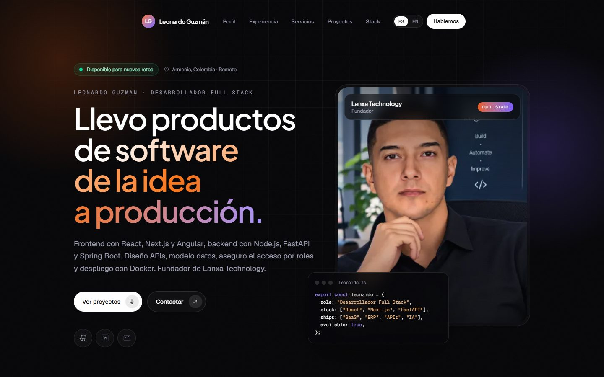
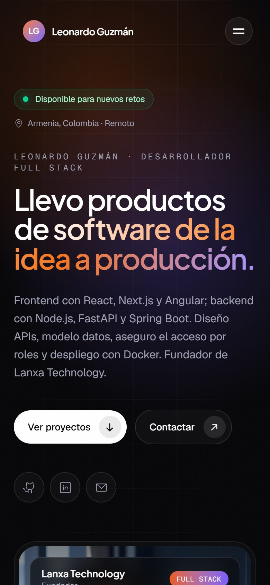

<p align="center">
  
  
  
  
  
  
</p>

<p align="center">
  Mi portafolio profesional: experiencia, servicios y proyectos en producción, en español e inglés.<br/>
  Pensado para que un reclutador o un cliente entienda en dos minutos qué construyo y cómo lo construyo.
</p>

---

## Vista previa

<p align="center">
  
  &nbsp;
  
</p>

## Qué incluye

| Sección | Contenido |
|---|---|
| **Inicio** | Presentación, disponibilidad, stack principal y cifras clave |
| **Perfil** | Cómo trabajo: full stack real, seguridad por diseño, rendimiento e IA aplicada |
| **Experiencia** | Línea de tiempo con Lanxa Technology, Bitwan, Super Ozono Global y LINK NETWORKS |
| **Servicios** | Aplicaciones web, SaaS y ERPs multi-tenant, APIs e integraciones, automatización e IA, auditoría y rendimiento |
| **Proyectos** | 15 proyectos con filtros por categoría, capturas reales, estado honesto (en línea, beta, en desarrollo, completado) y enlaces a demo y código |
| **Stack** | Lenguajes, frontend, backend, datos, infraestructura, calidad, IA y prácticas |
| **Formación** | Ingeniería de Software, certificaciones de Microsoft, Politécnico de Colombia y Udemy |
| **Contacto** | Correo con botón de copiar, WhatsApp, LinkedIn y GitHub |

## Detalles técnicos

- **Bilingüe ES / EN** con selector y detección del idioma del navegador; la preferencia se guarda en el dispositivo.
- **Responsive mobile-first**: menú a pantalla completa en celular, grillas que pasan a una columna y sin scroll horizontal en pantallas de celular.
- **Páginas estáticas** generadas en el build: carga rápida y ~190 kB de JavaScript inicial.
- **SEO**: metadatos, imagen Open Graph generada con la foto, `sitemap.xml`, `robots.txt` y datos estructurados `Person` (schema.org).
- **Accesibilidad**: navegación por teclado, foco visible, enlace para saltar al contenido y animaciones que respetan `prefers-reduced-motion`.
- **Animaciones** con Framer Motion basadas en `IntersectionObserver`, solo sobre `transform` y `opacity`.
- **Contenido tipado** en un solo archivo: el texto se actualiza sin tocar componentes.

## Estructura

```
app/
  layout.tsx            Fuentes, metadatos y datos estructurados
  page.tsx              Orden de las secciones
  opengraph-image.tsx   Imagen para compartir en LinkedIn y WhatsApp
  sitemap.ts · robots.ts
components/             Una sección por archivo (hero, experience, projects, contact…)
lib/
  content.ts            Experiencia, servicios, proyectos, stack y formación (ES / EN)
  site.ts               Correo, WhatsApp, redes y URL del sitio
  i18n.ts               Tipos de idioma
public/                 Foto y capturas de los proyectos
```

## Correr en local

Requisitos: Node.js 20 o superior.

```bash
npm install
npm run dev        # http://localhost:3000
```

```bash
npm run build      # build de producción
npm start          # sirve el build
npm run typecheck  # verificación de tipos
npm run lint
```

## Actualizar el contenido

- **Textos, proyectos y experiencia** → `lib/content.ts`. Cada texto tiene su versión `es` y `en`.
- **Datos de contacto** → `lib/site.ts`.
- **Nuevo proyecto con captura** → agregar la imagen en `public/projects/` y la ruta en el campo `image` del proyecto.
- **CV descargable** → copiar el PDF en `public/` y poner su ruta en `cvPath` (`lib/site.ts`).

## Despliegue

Pensado para **Vercel**: importar el repositorio y definir la variable de entorno

```
NEXT_PUBLIC_SITE_URL=https://tu-dominio.com
```

para que el sitemap, las URLs canónicas y la imagen de vista previa apunten al dominio final.

---

<p align="center">
  <a href="mailto:leonardecoj@gmail.com">
    
  </a>
  <a href="https://wa.me/573226993891">
    
  </a>
  <a href="https://linkedin.com/in/leonardo-guzman-t">
    
  </a>
  <a href="https://github.com/leonardeco">
    
  </a>
</p>

<p align="center"><i>Abierto a posiciones Full Stack, Frontend o Backend y a proyectos freelance.</i></p>


